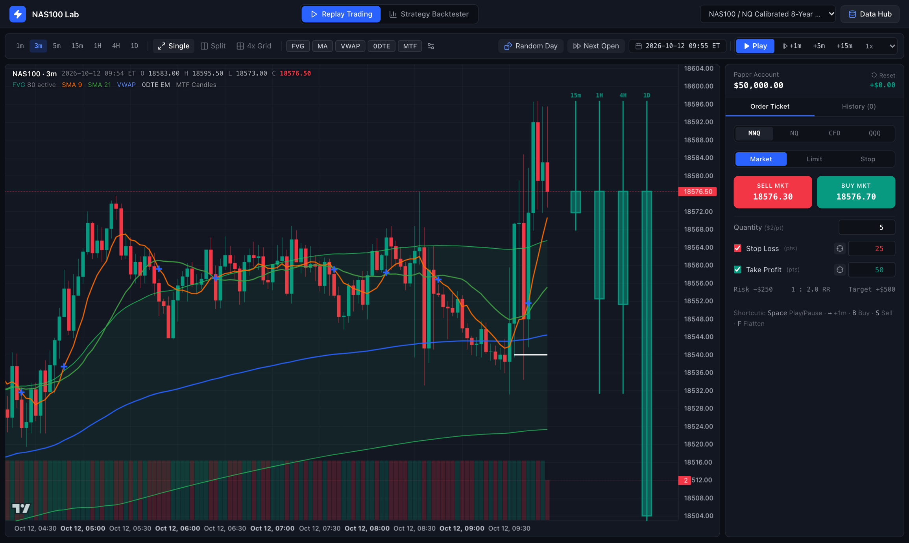
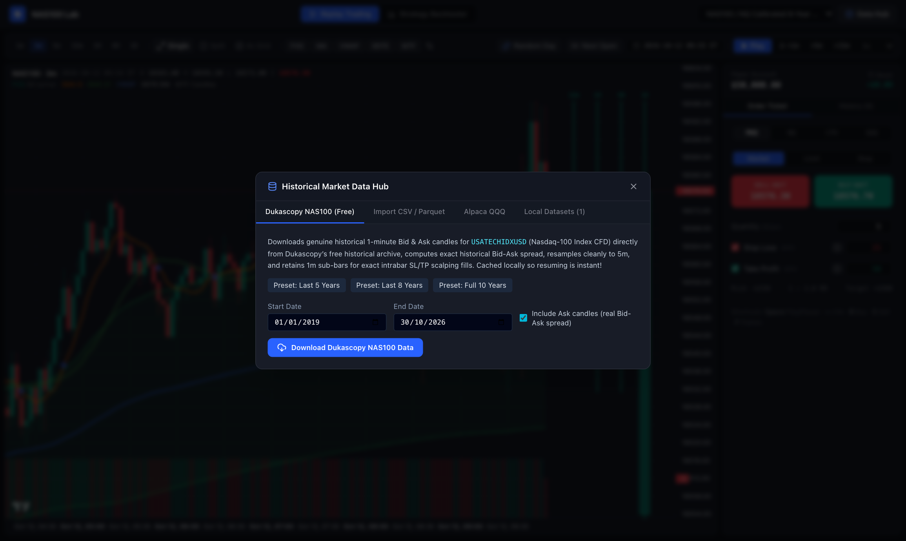
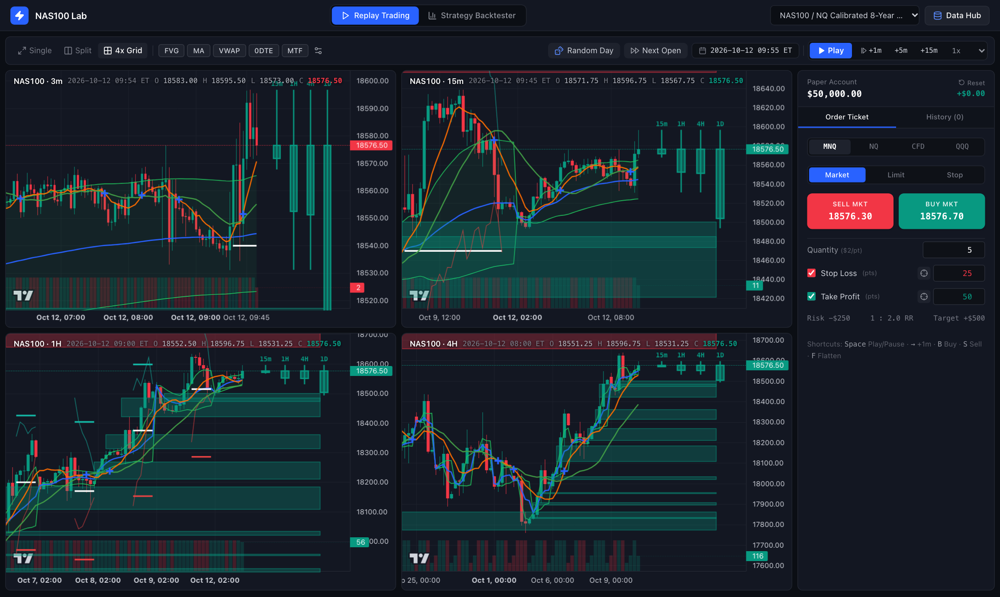
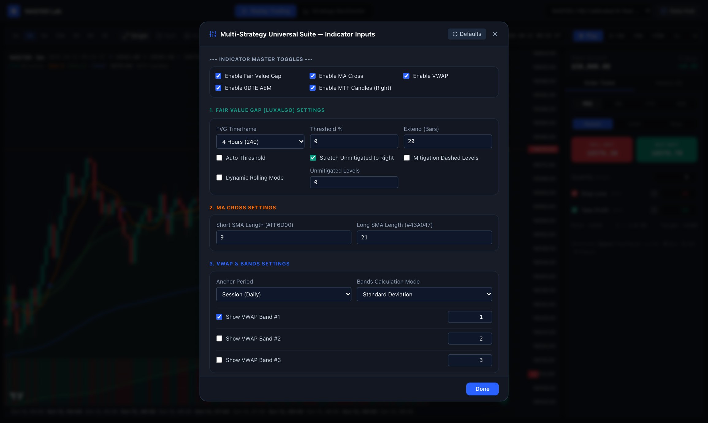
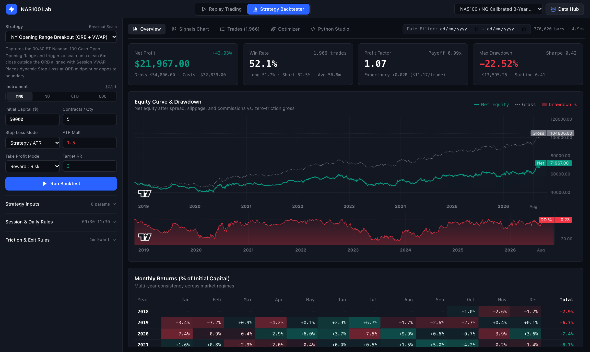
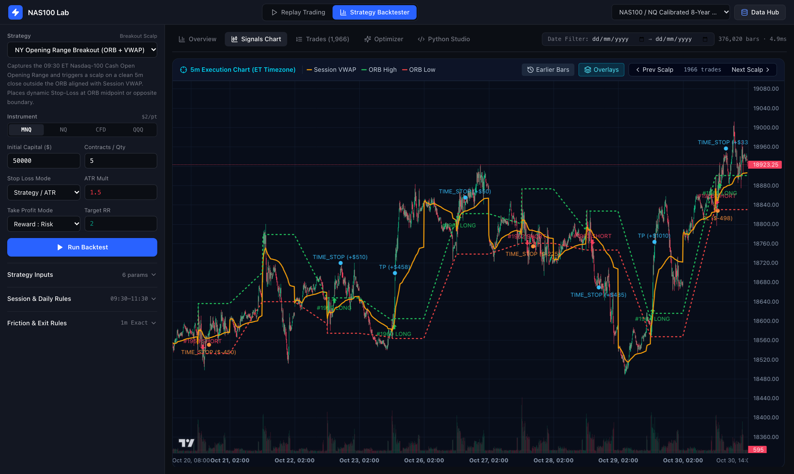
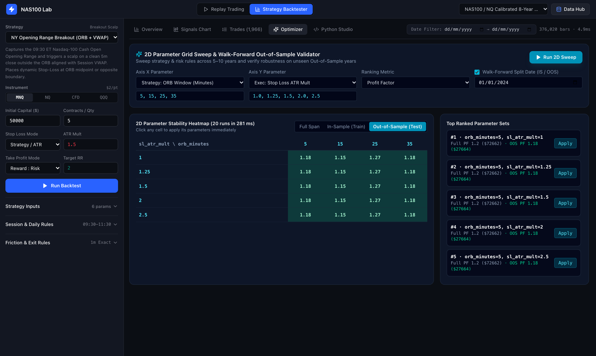
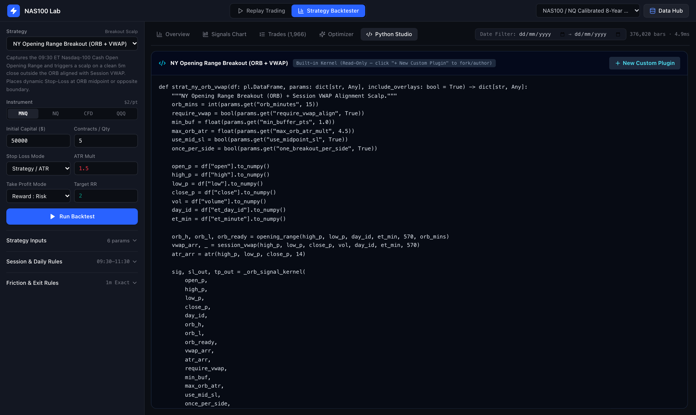

# NAS100 Lab — Local Nasdaq-100 Replay Simulator & Backtester

**NAS100 Lab** is a local, privacy-first **Live Historical Replay Trading Terminal** and **Multi-Year Strategy Backtester** purpose-built for **Nasdaq-100 (`NAS100` / `MNQ` / `NQ` / `QQQ`)** across **5–10+ years** of `1-minute` and `5-minute` market data.

Everything runs **100% locally on your machine** (FastAPI + Polars + Numba JIT backend paired with a clean TradingView Lightweight Charts UI) — no cloud subscriptions, no replay paywalls, and sub-100ms multi-year backtest execution.



---

## Table of Contents

1. [Beginner Quick Start (Step-by-Step)](#1-beginner-quick-start-step-by-step)
2. [Where Does the Market Data Come From?](#2-where-does-the-market-data-come-from)
3. [Feature Guide & Visual Tour](#3-feature-guide--visual-tour)
   - [3.1 Live Replay Trading & Multi-Timeframe Grid (`3m · 15m · 1H · 4H`)](#31-live-replay-trading--multi-timeframe-grid-3m--15m--1h--4h)
   - [3.2 Multi-Strategy Universal Suite (Built-in TradingView Overlay)](#32-multi-strategy-universal-suite-built-in-tradingview-overlay)
   - [3.3 Automated Multi-Year Strategy Backtester](#33-automated-multi-year-strategy-backtester)
   - [3.4 Signals Chart & Visual Trade Inspector](#34-signals-chart--visual-trade-inspector)
   - [3.5 2D Grid Optimizer & Walk-Forward Validator](#35-2d-grid-optimizer--walk-forward-validator)
   - [3.6 Python Strategy Studio](#36-python-strategy-studio)
4. [Supported Instruments & Friction Presets](#4-supported-instruments--friction-presets)
5. [Project Structure](#5-project-structure)
6. [Troubleshooting & FAQ](#6-troubleshooting--faq)

---

## 1. Beginner Quick Start (Step-by-Step)

Even if you have never run a Python or React project before, you can get **NAS100 Lab** running locally in **under 2 minutes**.

### Step 1: Install Prerequisites (One-Time Setup)

You need three free tools installed on your computer:
1. **Git** — to download this repository
2. **[uv](https://docs.astral.sh/uv/)** — a fast Python manager that automatically downloads Python 3.12+ and all backend libraries for you
3. **Node.js (v18 or newer)** — to build the web interface

**On macOS (using [Homebrew](https://brew.sh/)):**
```bash
brew install git uv node
```

**On Linux / Windows (WSL2):**
```bash
# Install uv (automatically manages Python)
curl -LsSf https://astral.sh/uv/install.sh | sh

# Install Node.js 20+ (Ubuntu/Debian example)
sudo apt update && sudo apt install -y git nodejs npm
```

---

### Step 2: Clone & Start with One Command

Open your **Terminal** app and run:

```bash
git clone git@github.com:ersin-demirtas/nasdaq100-backtester.git
cd nasdaq100-backtester
./start.sh
```

> **Note:** If you haven't set up SSH keys on GitHub yet, you can clone via HTTPS instead:
> `git clone https://github.com/ersin-demirtas/nasdaq100-backtester.git`

**What `./start.sh` does automatically on your first run:**
1. Creates an isolated Python environment in `backend/.venv` and installs FastAPI, Numba, Polars, and NumPy.
2. Installs frontend packages in `frontend/node_modules` and builds the web app into `frontend/dist`.
3. Generates an **8-year offline starter dataset** (`1-minute` + `5-minute` bars) in `data/datasets/` so the charts work immediately out of the box — even without internet access.
4. Starts the local server at **http://127.0.0.1:8000**.

### Step 3: Open the App in Your Browser

Visit **[http://127.0.0.1:8000](http://127.0.0.1:8000)** in Chrome, Brave, Edge, Safari, or Firefox.
To stop the server later, press `Ctrl + C` in your terminal window.

---

### Optional Developer Commands

If you are editing the source code and want live hot-reloading for both Python and React:

```bash
./dev.sh
# Backend API: http://127.0.0.1:8000
# Frontend HMR: http://localhost:5173
```

To run the automated backend test suite:

```bash
cd backend
.venv/bin/pytest
```

---

## 2. Where Does the Market Data Come From?

Click the **`Data Hub`** button in the top-right corner of the app at any time to download real historical candles or import your own files. All datasets are saved locally in `data/datasets/` as compressed Apache Parquet files (excluded from Git via `.gitignore` so your repository stays lightweight).



NAS100 Lab provides **four built-in data sources**:

### Source 1: Dukascopy Free Historical Archive (`NAS100` / `USATECHIDXUSD`) — *Recommended*
- **Cost / Keys Required:** **100% Free — No account or API key needed.**
- **What it downloads:** Genuine historical **1-minute Bid and Ask candles** for `USATECHIDXUSD` (Nasdaq-100 Index CFD) directly from Dukascopy Bank's public historical archive (`datafeed.dukascopy.com`).
- **Why it matters for scalping:**
  - Captures **real historical Bid-Ask spread** widening during volatile market opens and news releases.
  - Automatically builds `5-minute` candles **and** keeps every `1-minute` candle on disk so both Live Replay and Automated Backtests resolve exact intrabar Stop-Loss vs. Take-Profit fills.
  - Raw compressed daily `.bi5` files are cached in `data/cache/dukascopy/` — if you cancel a 10-year download halfway through and click Download later, it resumes instantly from where it left off.

### Source 2: Import Your Own CSV, TSV, or Parquet Files
- **Supported Platforms:** Drag-and-drop historical exports from **TradingView**, **NinjaTrader (`MNQ` / `NQ` CME futures)**, **Sierra Chart**, **Databento**, **FirstRateData**, **HistData**, or **MetaTrader 4/5**.
- **Smart Auto-Detection:**
  - Automatically detects `,`, `;`, or `Tab` delimiters.
  - Recognizes standard column names (`timestamp`/`time`/`date`/`datetime`, `open`, `high`, `low`, `close`, `volume`, `spread`).
  - Converts timestamps from `UTC`, `America/New_York`, or `America/Chicago` into unified `America/New_York` (`ET`) trading sessions (handling US Daylight Saving Time transitions automatically across every year).
  - If you upload `1-minute` bars, the importer automatically generates `5-minute` bars while preserving `1-minute` sub-bars.

### Source 3: Alpaca Market Data API (`QQQ` / `TQQQ`)
- Fetch 5–10 years of `1-minute` + `5-minute` US Equity ETF bars (`QQQ`, `TQQQ`, `SPY`) using a free [Alpaca Markets](https://alpaca.markets/) Paper Trading API Key & Secret (`IEX` free feed or `SIP` full tape).

### Source 4: Calibrated Offline Benchmark Dataset
- Built automatically on first launch (`8 years` by default; `5`, `8`, or `10 years` selectable in Data Hub → *Local Datasets*).
- Simulates realistic intraday Nasdaq-100 session microstructure (quiet Asian range, London sweep, `09:30 ET` NY Cash Open volatility burst, midday compression, and afternoon Power Hour) for instant offline testing.

---

## 3. Feature Guide & Visual Tour

The top navigation bar is intentionally streamlined into **two primary modes**:
1. **`Replay Trading`** — Manual bar-by-bar simulation on TradingView candlesticks with your indicators and a live paper-trading order ticket.
2. **`Strategy Backtester`** — Automated multi-year backtesting, performance analytics, trade inspection, parameter optimization, and custom Python coding.

---

### 3.1 Live Replay Trading & Multi-Timeframe Grid (`3m · 15m · 1H · 4H`)

Practice discretionary price-action trading on 5–10 years of historical data as if it were unfolding live — with **strict zero-lookahead causality** (higher-timeframe candles and indicators only reflect price action up to the exact simulated minute `sim_ts`).



- **Flexible Chart Layouts:**
  - **Single View:** Instantly switch between `1m`, `3m`, `5m`, `15m`, `1H`, `4H`, and `1D` without losing your place in time or open trades.
  - **Split View (`3m + 15m`):** Execution chart paired side-by-side with intermediate structure.
  - **4x Grid (`3m · 15m · 1H · 4H`):** Monitor all four timeframes simultaneously as each 1-minute tick forms.
- **Time Travel & Playback Controls:**
  - **`Random Day`:** Teleports to `09:20 ET` (10 minutes before the NY Cash Open) on a random trading day across your 5–10 year dataset for blind practice.
  - **`Next Open`:** Skips overnight chop directly to the next trading session's NY morning open.
  - **`Date Picker`:** Click the `ET` timestamp button in the toolbar to jump to any specific historical date and time (e.g., FOMC days, CPI mornings, or specific weeks).
  - **Playback:** Auto-play (`1x`, `3x`, `6x`, `Fast`, `Turbo`) or step manually by `+1m`, `+5m`, or `+15m`.
- **Paper-Trading Order Ticket:**
  - Trade **`MNQ`**, **`NQ`**, **`CFD`**, or **`QQQ`** on a persistent `$50,000` paper account.
  - Execute **Market**, **Limit**, or **Stop** orders with automatic **Stop Loss** and **Take Profit** brackets.
  - Click the **Crosshair** icon next to *Stop Loss*, *Take Profit*, or *Limit/Stop Price* to click levels directly on the candlestick chart.
  - Manage live trades with one-click **`Break-Even`**, **`50% Out`** (partial scale-out), and **`Flatten`**.
  - Every step evaluates your pending orders, Stop Loss, and Take Profit chronologically across constituent **1-minute sub-bars** including Bid/Ask spread, slippage, and round-turn commissions.

#### Replay Keyboard Shortcuts

| Key | Action |
| :--- | :--- |
| `Space` | Play / Pause candle replay |
| `→` (Right Arrow) | Advance `+1 minute` (or current step size) |
| `Shift + →` | Advance `+3 minutes` |
| `B` | Submit **Buy / Long** order |
| `S` | Submit **Sell / Short** order |
| `F` | **Flatten** open position immediately |
| `Esc` | Cancel chart price picker / close popovers |

---

### 3.2 Multi-Strategy Universal Suite (Built-in TradingView Overlay)

Toggle any indicator layer with **one click** right from the Replay toolbar (`FVG`, `MA`, `VWAP`, `0DTE`, `MTF`), or click the **Gear (`⚙`)** icon to customize every input parameter:



1. **Fair Value Gap [LuxAlgo] (`FVG`)**:
   - Supports higher-timeframe FVGs (`240` / 4-Hour default, `60` / 1-Hour, `15` / 15-Min, `D` / Daily) or `Chart` timeframe without repainting or future lookahead.
   - Automatically removes bullish (`#089981`) and bearish (`#f23645`) imbalance boxes the exact bar price closes through them, with optional dashed mitigation lines and dynamic rolling bands.
2. **Moving Average Cross (`MA`)**:
   - Plots customizable Short (`SMA 9`, `#FF6D00`) and Long (`SMA 21`, `#43A047`) simple moving averages with `#2962FF` `+` crossover markers.
3. **Anchored VWAP & Standard Deviation Bands (`VWAP`)**:
   - Anchors to `Session` (Daily), `Week`, `Month`, `Quarter`, or `Year` with up to 3 customizable `Standard Deviation` or `Percentage` bands and shaded zones.
4. **0DTE Anchored Expected Move (`0DTE`)**:
   - Anchors every trading day at the `09:30 ET` New York Cash Open (`Center` strike rounded to nearest 5 pts, static daily `EM High` / `EM Low`, and intraday theta-decaying `Running High` / `Running Low` curves).
   - Uses strictly prior 14-day realized daily volatility so Expected Move levels work across all **5–10 years** of historical simulation with zero lookahead.
5. **Right-Side Live Multi-Timeframe Candles (`MTF`)**:
   - Draws live-forming `15m`, `1H`, `4H`, and `1D` candles in the right margin of your chart so higher-timeframe candle bodies and wicks are visible at a glance.

---

### 3.3 Automated Multi-Year Strategy Backtester

Switch to **`Strategy Backtester`** in the top bar to test systematic rules across hundreds of thousands of bars in **under 100 milliseconds** (powered by Numba `@njit` machine-code compilation).



- **5 Built-in Intraday Nasdaq-100 Strategies:**
  1. **NY Opening Range Breakout (`ORB + Session VWAP`)** — Trades 5m close breakouts of the `09:30 ET` opening range aligned with Session VWAP.
  2. **Session VWAP + 9/21 EMA Pullback Scalp** — Trend-continuation entries on pullbacks into the fast EMA / VWAP pocket confirmed by RSI.
  3. **ICT Fair Value Gap (`FVG`) Displacement Scalp** — Detects institutional 3-candle displacement imbalances and enters on subsequent 5m retracements during NY Killzones.
  4. **Pre-Market High/Low Liquidity Sweep & Reclaim** — Tracks `03:00–09:30 ET` London/Pre-Market highs and lows, entering when NY Open sweeps stops and closes back inside range.
  5. **Keltner + RSI Exhaustion Mean-Reversion** — Fades extreme volatility spikes outside outer Keltner ATR bands.
- **Realistic Scalping Execution & Prop-Firm Rules:**
  - **1-Minute Sub-Bar Resolution:** Walks 1-minute candles inside every 5-minute bar to resolve exact Stop-Loss vs. Take-Profit priority, Break-Even triggers, 50% Partial scale-outs, and Trailing Stops.
  - **Net vs. Gross Equity Curve:** Plots your true net curve alongside a zero-friction gross curve so you see the exact dollar impact of spread, slippage, and commissions.
  - **Session & Prop Guardrails:** Filter entries to NY Killzones (`09:30–11:00 ET`, `10:00–11:00 ET Silver Bullet`, `US RTH`), enforce mandatory EOD flatten (`15:55 ET`), cap max trades per day, and halt trading on daily max loss or daily profit targets.
  - **Deep Breakdowns:** Multi-year Monthly Return `%` Heatmap, NY 30-minute Time-of-Day edge chart, Weekday & Exit Reason tables, R-Multiple histogram, and MAE vs. MFE excursion scatter plot.

---

### 3.4 Signals Chart & Visual Trade Inspector

Click **`Signals Chart`** (or click any row in the **`Trades`** log) to inspect exact entries, exits, stop-loss lines, take-profit targets, and strategy indicator overlays on an interactive 5-minute TradingView candlestick chart, with `Prev` / `Next` trade stepping buttons.



---

### 3.5 2D Grid Optimizer & Walk-Forward Validator

Click **`Optimizer`** to sweep any two strategy or risk parameters (e.g., *Opening Range Minutes* vs. *Reward:Risk Multiple*) across a 2D heatmap. Enable the **Out-of-Sample Walk-Forward Split** (e.g., optimize on `2018–2023` In-Sample and validate on unseen `2024–2026` Out-of-Sample data) to avoid curve-fitting, then apply any parameter cell in one click.



---

### 3.6 Python Strategy Studio

Click **`Python Studio`** to inspect the built-in Numba strategies or write and save your own custom Python strategies directly in the browser (saved automatically as `.py` files in `strategies/custom/`).



Custom strategies expose a clean dictionary + `run(df, params)` function:

```python
from app.engine.indicators import ema, atr
from app.models import ParamSpec
import numpy as np

STRATEGY_META = {
    "id": "my_custom_scalp",
    "name": "My Custom NAS100 Scalp",
    "category": "Custom",
    "description": "Example EMA crossover scalp with ATR structural stop.",
    "recommended_session": "NY_OPEN_KILLZONE",
    "params": [
        ParamSpec(name="fast_len", label="Fast EMA", type="int", default=9, min=3, max=50, step=1),
        ParamSpec(name="slow_len", label="Slow EMA", type="int", default=21, min=10, max=100, step=1),
    ],
}

def run(df, params, include_overlays=True):
    close = df["close"].to_numpy()
    high = df["high"].to_numpy()
    low = df["low"].to_numpy()

    fast = ema(close, int(params.get("fast_len", 9)))
    slow = ema(close, int(params.get("slow_len", 21)))
    atr14 = atr(high, low, close, 14)

    sig = np.zeros(len(close), dtype=np.int64)
    sl = np.full(len(close), np.nan)
    tp = np.full(len(close), np.nan)

    cross_up = (fast > slow) & (np.roll(fast, 1) <= np.roll(slow, 1))
    cross_dn = (fast < slow) & (np.roll(fast, 1) >= np.roll(slow, 1))
    cross_up[0] = False
    cross_dn[0] = False

    sig[cross_up] = 1
    sl[cross_up] = close[cross_up] - 1.5 * atr14[cross_up]

    sig[cross_dn] = -1
    sl[cross_dn] = close[cross_dn] + 1.5 * atr14[cross_dn]

    return {"signal": sig, "stop_price": sl, "target_price": tp, "overlays": {}}
```

---

## 4. Supported Instruments & Friction Presets

Both **Replay Trading** and the **Strategy Backtester** include pre-configured contract specifications that you can customize at any time:

| Preset | Instrument | Point Value | Tick Size | Default Spread | Default Commission / Side |
| :--- | :--- | :--- | :--- | :--- | :--- |
| **`MNQ`** | CME Micro E-mini Nasdaq-100 Futures | `$2.00 / pt` | `0.25` | `0.25 pt` | `$0.62` (`$1.24` RT) |
| **`NQ`** | CME E-mini Nasdaq-100 Futures | `$20.00 / pt` | `0.25` | `0.25 pt` | `$2.10` (`$4.20` RT) |
| **`CFD`** | `NAS100` / `USATECH` Prop-Firm CFD | `$1.00 / pt` | `0.10` | `1.00 pt` | `$0.00` (spread-baked) |
| **`QQQ`** | Invesco Nasdaq-100 ETF Shares | `$1.00 / sh` | `0.01` | `0.01 pt` | `$0.00` |

---

## 5. Project Structure

```text
nasdaq100-backtester/
├── start.sh                    # One-command setup & unified local launcher (http://127.0.0.1:8000)
├── dev.sh                      # Hot-reload launcher for backend + frontend development
├── docs/screenshots/           # Application screenshots referenced in documentation
├── data/                       # Local market data store (git-ignored)
│   ├── cache/dukascopy/        # Cached daily .bi5 archives for instant resume
│   └── datasets/               # ZSTD-compressed 1m + 5m Parquet datasets & metadata
├── strategies/custom/          # User-created Python strategy plugins (.py)
├── backend/
│   ├── pyproject.toml          # Python dependencies managed by uv
│   ├── app/
│   │   ├── main.py             # FastAPI endpoints (/api/replay/frame, /api/backtest, /api/data/*)
│   │   ├── config.py           # Instrument specs & NY session killzone presets
│   │   ├── data/               # Dukascopy, Alpaca, CSV/Parquet importer & Parquet store
│   │   ├── engine/             # Numba simulator, indicators, Universal Suite, analytics & optimizer
│   │   └── strategies/         # 5 built-in Numba strategies + dynamic custom plugin loader
│   └── tests/                  # Automated pytest suite
└── frontend/
    ├── package.json            # React 19 + TypeScript + Tailwind + Lightweight Charts
    └── src/
        ├── App.tsx             # Unified 2-mode workspace shell
        └── components/         # ReplaySimulator, UniversalSuiteChart, DataHub, Analytics, Optimizer
```

---

## 6. Troubleshooting & FAQ

- **Port `8000` is already in use:**
  Find and stop any previous server running on port `8000` with `lsof -ti :8000 | xargs kill`, then run `./start.sh` again.
- **Rebuilding the UI after pulling updates:**
  Run `npm --prefix frontend run build` (or delete `frontend/dist` and run `./start.sh`, which rebuilds automatically).
- **How much disk space does 10 years of 1-minute data use?**
  Thanks to ZSTD columnar Parquet compression, **8–10 years** of combined `1-minute` (~1.9M–2.4M bars) + `5-minute` (~380k–480k bars) Nasdaq-100 data uses only **~20–35 MB** on disk.
- **Does Replay Mode leak future data on 1H or 4H charts?**
  **Never.** Every replay step slices the underlying 1-minute dataset strictly at `ts <= sim_ts` before aggregating higher timeframes (`3m`, `15m`, `1H`, `4H`, `1D`) and computing indicators (`FVG`, `VWAP`, `SMA`, `0DTE AEM`). An incomplete 4-hour candle at `10:15 ET` shows only the high/low/close formed up to `10:15 ET`, identical to live trading.
